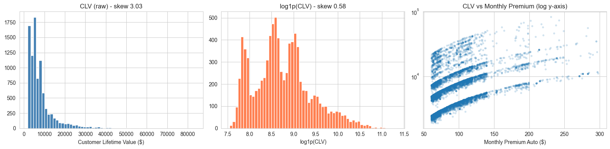
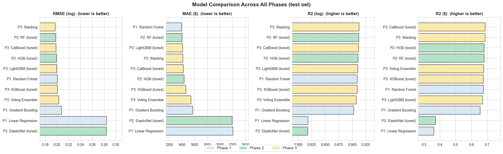
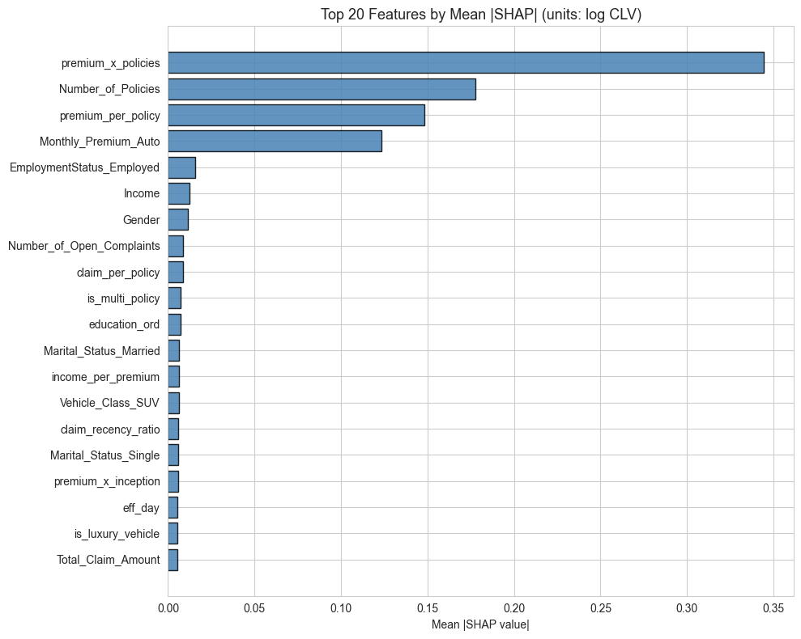
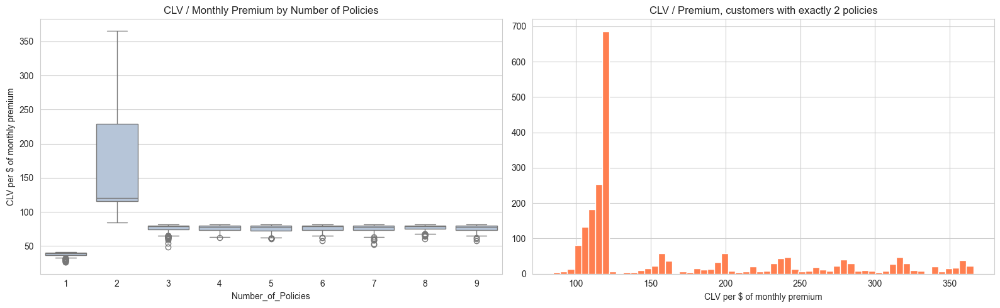
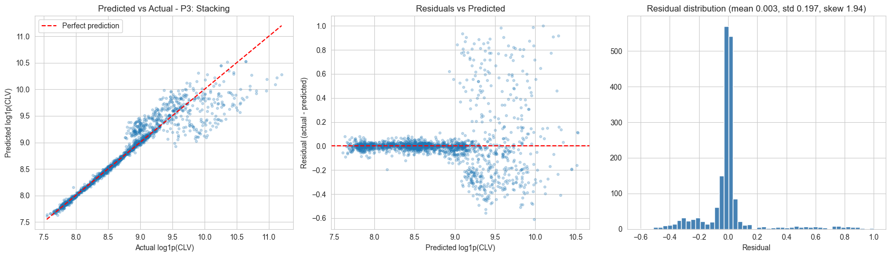
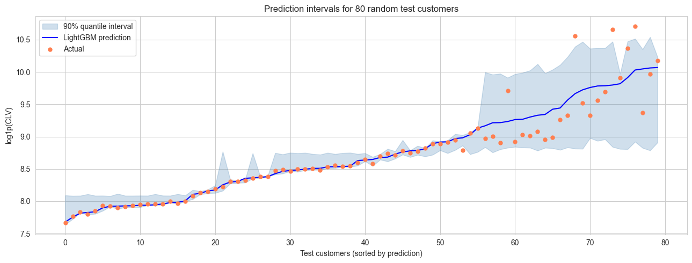

<div align="center">

# Auto Insurance Customer Lifetime Value

### Predicting what a customer is worth, from simple baselines to Bayesian-tuned gradient boosting


[Results](#-results) · [Key Findings](#-key-findings) · [Quick Start](#-quick-start) · [Project Structure](#-project-structure)

</div>

---

## 📖 Overview

This project predicts **Customer Lifetime Value (CLV)** for an auto-insurance book of business using the [IBM Watson Marketing Customer Value](https://www.kaggle.com/datasets/pankajjsh06/ibm-watson-marketing-customer-value-data) dataset.

| Customers | Features | Target | Skew |
|:---:|:---:|:---:|:---:|
| **9,134** | **24 columns** → 33 modeled | `Customer Lifetime Value` ($1.9k – $83k) | 3.03 → 0.58 after `log1p` |

The target is continuous and heavily skewed, so the pipeline centers on a log transform, RMSE / MAE / R² metrics, residual diagnostics and prediction intervals.

<div align="center">

<br><sub>The target is strongly right-skewed. Modeling <code>log1p(CLV)</code> tames the tail.</sub>
</div>

---

## 🧪 The Three Phases

| Phase | Approach | Key additions |
|-------|----------|---------------|
| **1 · Baselines** | Dummy, Linear Regression, Random Forest, Gradient Boosting | No tuning, 5-fold CV |
| **2 · Tuned sklearn** | ElasticNet, Random Forest, HistGradientBoosting | `RandomizedSearchCV` |
| **3 · Advanced boosting** | XGBoost, LightGBM, CatBoost | Optuna (TPE), voting + stacking, SHAP |

---

## 📊 Results

Test set of **1,827 customers**. Models predict `log1p(CLV)`; metrics are shown on the log scale and in dollars.

| Phase | Best model | RMSE (log) ↓ | R² (log) ↑ | R² ($) ↑ | MAE ($) ↓ | Runtime |
|:-----:|--------------|:-----------:|:---------:|:-------:|:--------:|:---------:|
| 1 | Random Forest | 0.2007 | 0.909 | 0.676 | 1,395 | ~10 s |
| 2 | RF (tuned) | 0.1975 | 0.912 | 0.680 | 1,406 | ~1.6 min |
| 3 | Stacking ensemble | **0.1970** | **0.912** | **0.686** | 1,415 | ~2.4 min |

> **For scale:** a mean-predicting dummy scores R² ≈ 0 and plain Linear Regression scores R² (log) 0.818 / R² ($) 0.362.

<div align="center">

<br><sub>Phase 1 → Phase 2 → Phase 3. The big jump is linear → tree, and it happens in Phase 1.</sub>
</div>

### The takeaway

> **Trees over linear models is the whole story, and it is already there in Phase 1.**
> Tuning and Optuna-tuned boosters improve RMSE by only ~0.003, which is noise-level for 1,827 test customers, while adding runtime, dependencies and complexity.

<details>
<summary><b>Full results table (all 12 models)</b></summary>

<br>

| Model | RMSE (log) | MAE (log) | R² (log) | MAE ($) | R² ($) |
|-------|:---------:|:--------:|:-------:|:------:|:-----:|
| P1: Dummy (mean) | 0.6659 | 0.5333 | -0.0018 | 4,176 | -0.0494 |
| P1: Linear Regression | 0.2839 | 0.1984 | 0.8179 | 2,201 | 0.3623 |
| P1: Random Forest | 0.2007 | 0.0925 | 0.9090 | 1,395 | 0.6759 |
| P1: Gradient Boosting | 0.2078 | 0.1089 | 0.9025 | 1,572 | 0.6553 |
| P2: ElasticNet (tuned) | 0.2842 | 0.1979 | 0.8175 | 2,189 | 0.3717 |
| P2: RF (tuned) | 0.1975 | 0.0935 | 0.9118 | 1,406 | 0.6797 |
| P2: HGB (tuned) | 0.1988 | 0.0974 | 0.9107 | 1,436 | 0.6800 |
| P3: XGBoost (tuned) | 0.2008 | 0.0982 | 0.9090 | 1,464 | 0.6760 |
| P3: LightGBM (tuned) | 0.1995 | 0.0931 | 0.9101 | 1,414 | 0.6713 |
| P3: CatBoost (tuned) | 0.1982 | 0.0987 | 0.9113 | 1,425 | 0.6869 |
| P3: Voting Ensemble | 0.2027 | 0.1124 | 0.9072 | 1,543 | 0.6766 |
| P3: Stacking | 0.1970 | 0.0955 | 0.9123 | 1,415 | 0.6862 |

</details>

---

## 🔍 Key Findings

### 1. The drivers are all about premium and policy count

<div align="center">

</div>

Four features carry almost all of the importance (mean \|SHAP\| 0.12 – 0.34 each); everything else is below 0.02:

| Rank | Feature | What it is |
|:---:|---------|-----------|
| 1 | `premium_x_policies` | Engineered: monthly premium × number of policies |
| 2 | `Number_of_Policies` | Behaves as three regimes: 1, 2, and 3+ |
| 3 | `premium_per_policy` | Engineered: premium ÷ policies |
| 4 | `Monthly_Premium_Auto` | Raw monthly premium |

### 2. The ceiling is in the data, not the model

Customers with **exactly two policies** are **25%** of the test rows but **98%** of the squared error.

<div align="center">

<br><sub>CLV ÷ premium is nearly constant for 1 policy (~39) and 3+ policies (~78), but bimodal for 2 policies.</sub>
</div>

- For every other policy count, the typical error is about **2%**
- For two-policy customers, **no feature predicts** which multiplier cluster they fall into (cross-validated R² = **0.02**)
- More tuning cannot fix missing information

### 3. The dataset looks synthetic

CLV is almost exactly `premium × ~39` (1 policy) or `premium × ~78` (3+ policies). Real insurance data is never this clean, so read the absolute accuracy as a property of **this dataset**, not as a benchmark.

### 4. Residuals: accurate for most, heavy-tailed overall

<div align="center">

</div>

The median absolute residual is ~0.023 (≈2%), yet the worst 5% of predictions produce ~64% of the squared error.

### 5. Prediction intervals: adaptive vs guaranteed

<div align="center">

</div>

| Method | Empirical coverage (target 90%) | Mean width (log units) |
|--------|:-----------------------------:|:----------------------:|
| Quantile LightGBM | 87.9% | 0.496 |
| Conformal (CV residuals) | 90.1% | 0.649 |

Quantile intervals are narrower and adapt to the customer but slightly under-cover. The conformal band is correctly calibrated but ~30% wider because it uses one width for everyone.

### 6. Does the log transform help?

Training the tuned HGB on raw dollars vs `log1p`, judged in dollars:

| Setup | MAE ($) | RMSE ($) | R² ($) |
|-------|:------:|:-------:|:-----:|
| Raw target | 1,633 | 4,005 | 0.689 |
| `log1p` target | **1,436** | 4,061 | 0.680 |

The log cuts typical error by ~12% but is marginally worse on the dollar-weighted metrics. Pick based on what the business cares about.

---

## 🚀 Quick Start

```bash
# 1. Create and activate a virtual environment (Python 3.11+)
python3 -m venv .venv
source .venv/bin/activate        # Windows: .venv\Scripts\activate

# 2. Install pinned dependencies
pip install -r requirements.txt

# 3. (Optional) register a Jupyter kernel
python -m ipykernel install --user --name data_clv --display-name "Python (data_clv)"

# 4. Open the notebook and run all cells (~5 minutes)
jupyter lab CLV_DA.ipynb
```

---

## 🗂 Project Structure

```
data_clv/
├── clv_auto_insurance.csv     # Raw dataset (9,134 rows)
├── CLV_DA.ipynb               # All three phases, EDA, diagnostics, SHAP
├── requirements.txt           # Pinned dependencies
├── README.md                  # This file
└── images/                    # Figures used in this README
```

---

<div align="center">

**See also:** the [classification counterpart](https://github.com/andreslunagodoy/data_churn), predicting customer churn with the same pipeline.

</div>
